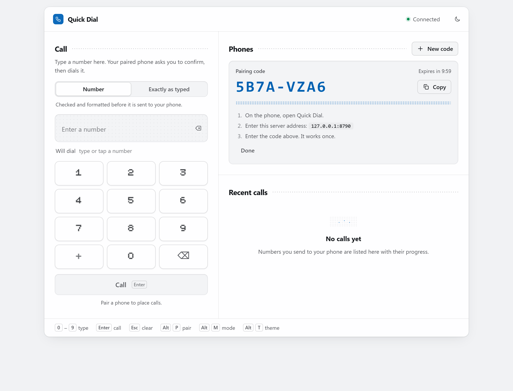
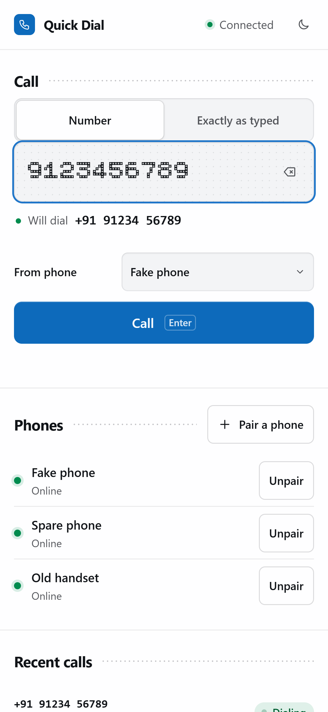
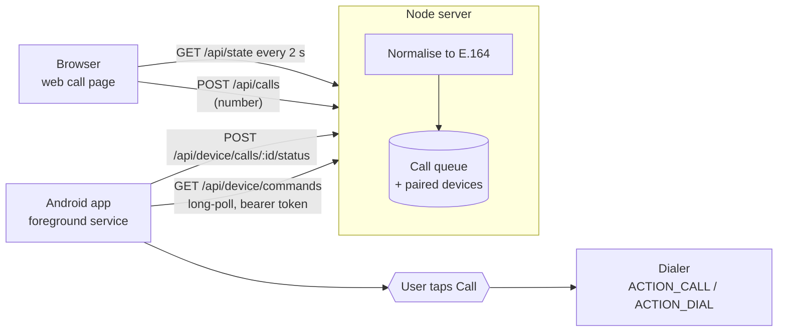
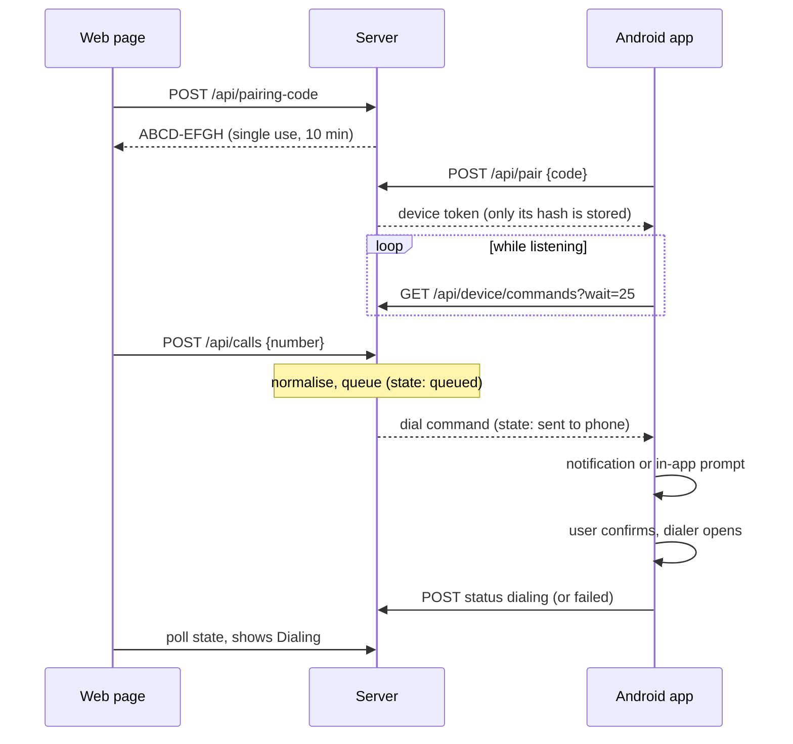

# Fcm-Calling

Type a phone number on a web page. Your paired Android phone asks you to confirm, then dials it.

That is the whole product: a tiny Node server, one static page, and a small Kotlin and Jetpack Compose app. No accounts, no Firebase or Google services, no cloud. Everything runs on your own machine unless you decide otherwise.

It is a portfolio project, small on purpose. Read the [status](#status) section before trusting it with anything important.


| Pairing | Dark | Phone (375 px) |
| --- | --- | --- |
|  |  |  |

More: [empty state](docs/screenshots/01-empty.png), [number preview](docs/screenshots/03-number-preview.png), [unpair confirmation](docs/screenshots/05-confirm-unpair.png), [error state](docs/screenshots/07-error-state.png), [mobile, full page](docs/screenshots/09-mobile-full.png), [mobile dark](docs/screenshots/10-mobile-dark.png).

Android app design notes: [docs/ANDROID-DESIGN.md](docs/ANDROID-DESIGN.md).

## How it works





Call states shown on the page:

| State | Meaning |
| --- | --- |
| Queued | The server has it; the phone has not fetched it yet. Fails after 2 minutes if the phone never shows up. |
| Sent to phone | The phone received the command. It is waiting for you to confirm. Fails after 5 minutes without an answer. |
| Dialing | You confirmed and the app handed the number to the dialer. This is as far as any app can honestly know. |
| Failed | Invalid, declined on the phone, expired, no dialer, or the phone was unpaired. The reason is shown. |

The phone never dials without a tap. That is deliberate: anything that can make your phone place calls remotely is an attractive target (premium-rate numbers), so a human confirmation is the last line of defence.

## Dialling anything: the "exactly as typed" option

Tick **Dial exactly as typed** on the web page (or the switch on the phone's own screen) and the text is sent to the phone untouched: short codes like `112`, `*#06#`, extensions, pauses (`,`) and so on, up to 32 characters. Only empty text, over-long text and control or invisible characters are refused. The phone still asks you to confirm before dialling, and the call list marks these as "as typed". Mind that some codes (USSD, call forwarding such as `*21*…#`) change settings on your line when dialled.

## Run it

Requirements: Node 22.18 or newer (24 recommended). Nothing else for the server.

```bash
cd server
npm install        # dev dependencies only: typescript and @types/node
npm start          # builds the page script, then serves http://127.0.0.1:8787
```

Open http://127.0.0.1:8787, press **Pair a phone**, and enter the code in the Android app.

No phone handy? A scripted stand-in speaks the same protocol:

```bash
node scripts/fake-phone.ts http://127.0.0.1:8787 ABCD-EFGH accept   # or: decline
```

Configuration lives in environment variables; copy [`.env.example`](.env.example) to `server/.env`. The important ones: `DEFAULT_COUNTRY` (IN, US, GB or AU), `HOST`, `PORT`, `ACCESS_KEY`, `ALLOWED_HOSTS`.

### Android app

Open `android/` in Android Studio, or from a shell with JDK 17 and the Android SDK:

```bash
cd android
./gradlew testDebugUnitTest assembleDebug
# app/build/outputs/apk/debug/app-debug.apk
```

On the Android emulator, the host machine is `10.0.2.2`, so use `10.0.2.2:8787` as the server address. On a real phone use your computer's LAN or private-network address (see below).

## Phone numbers

The server is the authority and the Android app has a twin implementation. Both are checked against one shared table, [`shared/phone-cases.json`](shared/phone-cases.json) (72 cases, more than half Indian). The Indian numbers in that table are drawn at random each time it is regenerated (`node shared/make-cases.cjs`, or `SEED=<n>` to reproduce), and the unit tests also draw fresh random numbers every run, so no fixed number appears in the test code. Accepted inputs for an Indian default include a bare 10 digits, a leading trunk `0`, `+91` with spaces or dashes, `91…`, `0091…`, `+91 (0) …` and landlines like `011 xxxx xxxx`; all become the same `+91…` number. Letters, extensions, wrong lengths, a leading zero after the country code and other junk are rejected with a specific reason.

Supported default countries: IN, US, GB, AU. A `+` number from any other country is accepted if it is the right shape for E.164 (8 to 15 digits). That is a length check, not a carrier lookup. A number that passes can still not exist.

## Exposing it safely

By default the server listens on `127.0.0.1` only, so only your computer can reach it. To reach it from a phone you must listen on another interface. Read this first.

**What is at stake.** Whoever can use the web API can make your phone offer to call any number. The confirmation tap limits the damage but does not remove it.

**What the server does for you**

- `ACCESS_KEY` (12+ characters) is optional, including beyond loopback, because the phone still asks before every call. When it is set the web page shows an access key field once and remembers the key in that browser. The server prints a reminder when it listens on the network without one.
- Pairing uses a one-time 8-character code (about 40 bits), valid 10 minutes, burned after 5 wrong guesses or one success. Only a SHA-256 hash of each device token is stored.
- Rate limits: 5 pairing attempts per minute per address, 10 calls per minute, 5 codes per minute, lockout after 10 failed access-key or token attempts.
- Browser requests must be same-origin and `application/json`, which blocks drive-by posts from other websites to `localhost`. The `Host` header must be `localhost`, `127.0.0.1`, `[::1]` or listed in `ALLOWED_HOSTS`, which blocks DNS rebinding.
- Strict CSP on the page, no CORS headers, 4 KB body limit.

**Recommended setup: a private network such as [Tailscale](https://tailscale.com/).** Both your computer and phone join the same private network, nothing is open to the internet.

```bash
# server/.env
HOST=0.0.0.0                       # or your private-network address only
ACCESS_KEY=<long random secret>
ALLOWED_HOSTS=<private IP or name the phone and browser will use>
```

Then use `http://<that address>:8787` in the browser and in the app. Prefer binding to the private-network address instead of `0.0.0.0` so the LAN cannot reach it either.

**Do not**

- Forward the port on your router or put it on the public internet.
- Rely on the access key over plain HTTP across an untrusted network. The key and the device token travel unencrypted on `http://`. Inside a WireGuard-based private network that traffic is already encrypted; on ordinary Wi-Fi it is not. If you need HTTPS, put a TLS-terminating reverse proxy in front.
- Trust `X-Forwarded-For`. The server ignores it, so behind a reverse proxy every client shares one rate-limit bucket.

More detail in [docs/SECURITY.md](docs/SECURITY.md).

## Android limits, honestly

Short version: the phone receives commands reliably only while the foreground service is alive, and Android can start the dialer only from something you tap. Details, including what was and was not verified, are in [docs/ANDROID-LIMITS.md](docs/ANDROID-LIMITS.md).

## Tests

| Suite | Command | Count |
| --- | --- | --- |
| Server (node:test): phone table, limiter, config, store, HTTP API | `cd server && npm test` | 140 |
| Android (JUnit): shared phone table, command parser, server URL, status mapping | `cd android && ./gradlew testDebugUnitTest` | 26 |

CI ([.github/workflows/ci.yml](.github/workflows/ci.yml)) typechecks and tests the server, then runs Android unit tests, lint and `assembleDebug`, and uploads the debug APK.

## Layout

```
server/            Node + TypeScript API and the page (server/public/index.html plus server/web/app.ts, compiled to public/app.js by `npm run build:web`)
  src/             phone.ts, store.ts, limiter.ts, config.ts, app.ts, server.ts
  test/            node:test suites
  scripts/         fake-phone.ts, a stand-in for the Android app
android/           Kotlin + Jetpack Compose app (package dev.quickdial)
shared/            phone-cases.json, the table both test suites run
docs/              ANDROID-LIMITS.md, SECURITY.md, screenshots
```

## Status

Honest accounting as of the first commit series.

| Part | State |
| --- | --- |
| Server API, pairing, rate limits, persistence | Implemented and covered by 132 passing tests. |
| Web page | Implemented. Exercised in a real browser (Edge via Playwright) against the real server, using the scripted phone. Screenshots in `docs/screenshots/`. |
| Android app | Compiles with AGP 8.13 and Kotlin 2.2. 26 JVM unit tests pass. `lintDebug` reports no errors. Debug APK builds. The Compose UI is a small design system (`ui/Theme.kt`, `ui/Components.kt`, `ui/Screens.kt`) with bundled open-licence fonts. |
| Android runtime behaviour | **Not verified on a device.** The app screenshots were removed. The UI is checked by unit tests, lint and the Compose `@Preview` functions only; the foreground service, notification actions, full-screen intent, runtime permissions, the real dialer hand-off and TalkBack have not been seen working. Treat them as untested. |
| Plain HTTP only | No TLS in the server; see the safety notes. |
| One process, in-memory limits | Fine for one person, not designed for multiple instances. |

Known gaps and trade-offs, by choice:

- The web page script is TypeScript too (`server/web/app.ts`), compiled with `tsc` on `npm start` and `npm test`.
- The device token is stored in ordinary private app storage, not the Keystore.
- Cleartext HTTP is allowed in the app because LAN and private-network addresses rarely have certificates.
- No boot receiver. After a reboot open the app once to resume listening.
- No call history on the phone and no call-log reading; the app never learns whether the other party picked up.
- Only four default countries have strict rules.

## Licence

MIT, see [LICENSE](LICENSE).
