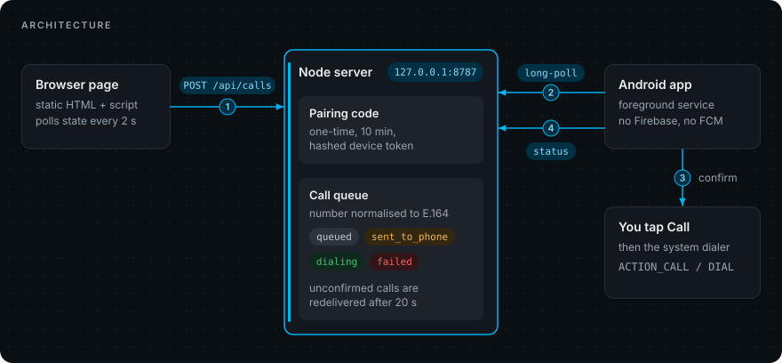
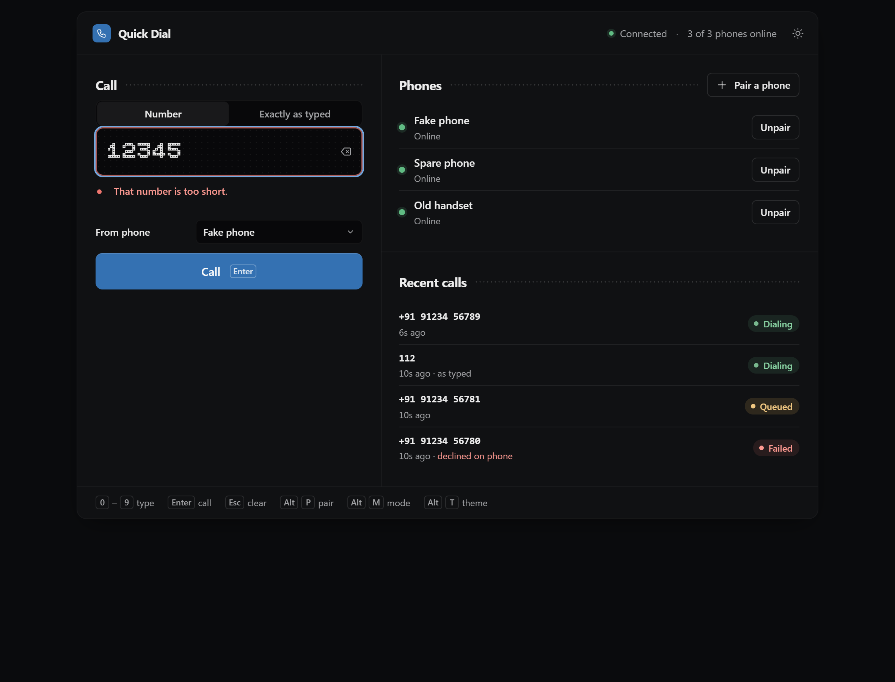

# Call-Relay

Type a phone number on a web page. Your paired Android phone asks you to confirm, then dials it.

There is no Firebase or Google service involved: the phone long-polls the server.

It is a small personal project: a Node server, one static page, and a Kotlin / Jetpack Compose app. No accounts, no cloud; it runs on your own machine.




| Pairing | Dark | Phone (375 px) |
| --- | --- | --- |
|  |  |  |

## How it works

1. On the page, **Pair a phone** shows a one-time code (10 minutes). Entering it in the app returns a device token; the server stores only its hash.
2. The app keeps a foreground service running that calls `GET /api/device/commands?wait=25`.
3. Submitting a number (`POST /api/calls`) normalises it to E.164 and queues it.
4. The phone receives the command and shows a notification or in-app prompt. Nothing dials until you tap.
5. The app opens the dialer and reports `dialing` (or `failed`) to the server. The page polls `/api/state` every 2 s.

| State | Meaning |
| --- | --- |
| `queued` | On the server, not yet fetched. Fails after 2 minutes (`COMMAND_TTL_SECONDS`). |
| `sent_to_phone` | Delivered, waiting for your tap. Redelivered after 20 s if unreported; fails after 5 minutes. |
| `dialing` | You confirmed and the number was handed to the dialer. The app cannot know more than that. |
| `failed` | Invalid number, declined, expired, no dialer, or unpaired. The reason is shown. |

The confirmation tap is deliberate: anything that can place calls remotely is a target for premium-rate abuse.

**Dial exactly as typed** (a checkbox on the page, a switch in the app) sends the text untouched, for things like `112`, `*#06#` or extensions, up to 32 characters. Some codes, such as call forwarding, change settings on your line.

## Quick start

Needs Node 22.18 or newer.

```bash
cd server
npm install
npm start          # http://127.0.0.1:8787
```

Open the page, press **Pair a phone**, and enter the code in the app. To try it without a phone, a script speaks the same protocol:

```bash
node scripts/fake-phone.ts http://127.0.0.1:8787 ABCD-EFGH accept   # or: decline
```

Android app (JDK 17 and the Android SDK, or Android Studio):

```bash
cd android
./gradlew testDebugUnitTest assembleDebug   # app/build/outputs/apk/debug/app-debug.apk
```

On a phone, point the app at your computer's LAN or private-network address.

Configuration is by environment variables; copy [`.env.example`](.env.example) to `server/.env`. The main ones are `DEFAULT_COUNTRY` (IN, US, GB, AU), `HOST`, `PORT`, `ACCESS_KEY` and `ALLOWED_HOSTS`.

## Phone numbers

The server is the authority; the Android app has a matching implementation. Both run against one table, [`shared/phone-cases.json`](shared/phone-cases.json). Strict rules exist for IN, US, GB and AU. A `+` number from elsewhere is accepted if it is 8 to 15 digits, which is a length check only, not a lookup.

## Exposing it beyond localhost

The server listens on `127.0.0.1` by default. Anyone who can use the web API can make your phone offer to call a number, so the tap is the last line of defence.

- `ACCESS_KEY` (12+ characters) is optional. When set, the page asks for it once.
- Pairing codes are single use, burned after 5 wrong guesses.
- Rate limits on pairing, calls and failed key attempts; 4 KB body limit; strict CSP; no CORS.
- Browser requests must be same-origin JSON, and `Host` must be loopback or in `ALLOWED_HOSTS` (blocks DNS rebinding).

Use a private network such as Tailscale, with `HOST` set to that interface's address, `ACCESS_KEY` set and `ALLOWED_HOSTS` listing the name you will use. Do not forward the port to the internet. There is no TLS, so on untrusted Wi-Fi the key and device token travel in plain text; put a TLS reverse proxy in front if needed. `X-Forwarded-For` is ignored, so behind a proxy all clients share one rate-limit bucket.

More in [docs/SECURITY.md](docs/SECURITY.md).

## Tests

```bash
cd server && npm test                          # node:test: phone table, limiter, config, store, HTTP API
cd android && ./gradlew testDebugUnitTest      # JUnit: phone table, command parser, server URL, status mapping
```

CI runs the server typecheck and tests, then the Android unit tests, lint and `assembleDebug`.

## Layout

```
server/    Node + TypeScript API; page in public/ and web/app.ts
  src/     phone, store, limiter, config, app, server
  test/    node:test suites
  scripts/ fake-phone.ts, a stand-in for the app
android/   Kotlin + Compose app (package dev.quickdial)
shared/    phone-cases.json used by both test suites
docs/      ANDROID-LIMITS.md, ANDROID-DESIGN.md, SECURITY.md, img/, screenshots/
```

## Limitations

- The Android UI is verified by unit tests, lint and Compose previews, not by an emulator. Foreground service behaviour, notification actions, permissions and the real dialer hand-off are not verified on a device; see [docs/ANDROID-LIMITS.md](docs/ANDROID-LIMITS.md).
- Commands arrive reliably only while the foreground service is alive. There is no boot receiver; open the app once after a reboot.
- Plain HTTP only. The app allows cleartext because LAN addresses rarely have certificates.
- The device token sits in private app storage, not the Keystore.
- One process with in-memory rate limits; not built for multiple instances.
- No call history, and the app never learns whether the other side picked up.

## Licence

MIT, see [LICENSE](LICENSE).
