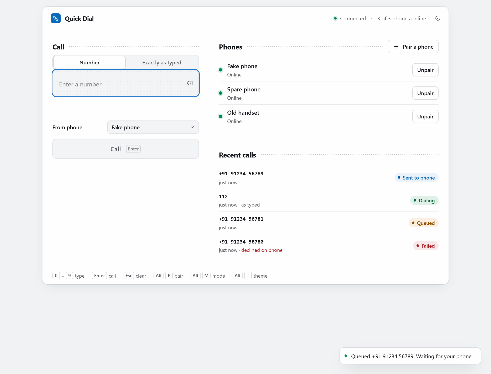

# Call-Relay

Type a phone number on a web page and your paired Android phone asks you to confirm, then dials it.



## What it does

- One-time 8-character pairing code: 10 minutes, 5 wrong guesses; device token stored as a hash
- No Firebase or Google service: the phone long-polls the server
- E.164 normalisation, strict rules for IN, US, GB, AU; other `+` numbers length-checked (8-15 digits)
- Nothing dials without a tap; states `queued` (2 min TTL), `sent_to_phone` (redelivered after 20 s, fails at 5 min), `dialing`, `failed`
- Raw mode dials up to 32 characters as typed (`*#06#`, extensions); some codes change line settings

## Quick start

Prerequisites: Node 22.18+; JDK 17 and the Android SDK for the app.

```bash
cd server && npm install && npm start                                     # page on http://127.0.0.1:8787
node server/scripts/fake-phone.ts http://127.0.0.1:8787 ABCD-EFGH accept  # stand-in phone (or: decline)
cd android && ./gradlew testDebugUnitTest assembleDebug                   # APK in app/build/outputs/apk/debug/
```

Press **Pair a phone** and enter the code in the app, pointed at your computer's LAN or private-network address. Settings: copy [`.env.example`](.env.example) to `server/.env`.

## API

| Method | Path | Used by |
| --- | --- | --- |
| `POST` | `/api/pairing-code` | Page: new pairing code |
| `POST` | `/api/pair` | App: code for device token |
| `POST` / `GET` | `/api/calls` | Page: queue a number / last 10 calls |
| `GET` | `/api/state`, `/api/normalize` | Page: polled every 2 s / number preview |
| `GET` | `/api/device/commands?wait=25` | App: long-poll |
| `POST` | `/api/device/calls/:id/status` | App: report `dialing` or `failed` |
| `DELETE` | `/api/device`, `/api/devices/:id` | App / page: unpair |

The server binds to `127.0.0.1`. Optional `ACCESS_KEY` (12+ characters); rate limits; 4 KB bodies; same-origin JSON only; `Host` must be loopback or in `ALLOWED_HOSTS`. Beyond localhost use a private network such as Tailscale; do not forward the port to the internet. See [docs/SECURITY.md](docs/SECURITY.md).

## Architecture


- `server/src`: Node + TypeScript API, in-memory store, limiter, phone rules
- `server/public`, `server/web`: the static page
- `android/`: Kotlin + Compose app; a foreground service runs the long-poll
- `shared/phone-cases.json`: number cases both test suites run against

## Tests

```bash
cd server && npm test                       # node:test
cd android && ./gradlew testDebugUnitTest   # JUnit
```

CI adds the server typecheck, Android lint and `assembleDebug`.

## Layout

```
server/    API, page, tests, scripts/fake-phone.ts
android/   Kotlin + Compose app (dev.quickdial)
shared/    phone cases for both suites
docs/      Android limits and design, security, screenshots
```

## Limitations

- Android UI verified by unit tests, lint and Compose previews only; service, notifications, permissions and dialer hand-off are unverified on hardware. See [docs/ANDROID-LIMITS.md](docs/ANDROID-LIMITS.md).
- Commands arrive only while the foreground service runs; no boot receiver, so open the app after a reboot.
- Plain HTTP; key and device token travel in clear text unless a TLS reverse proxy is in front.
- `X-Forwarded-For` is ignored: behind a proxy all clients share one rate-limit bucket.
- The device token sits in private app storage, not the Keystore.
- Single process, in-memory rate limits.
- No persistent call history (last 100 calls in memory), and the app never learns whether the other side picked up.

## Licence

MIT, see [LICENSE](LICENSE).
